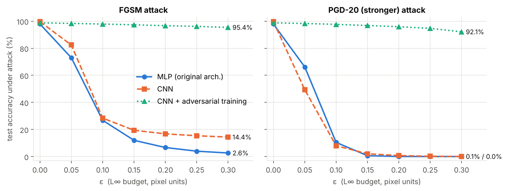
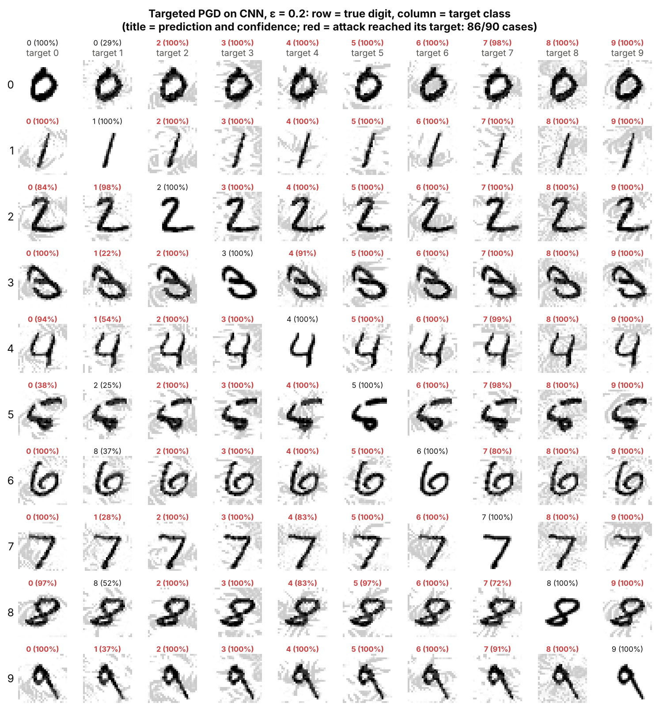
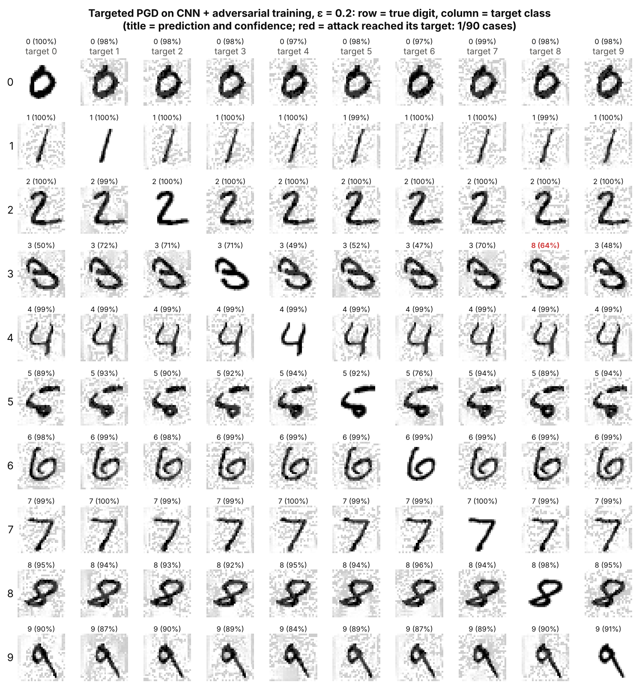
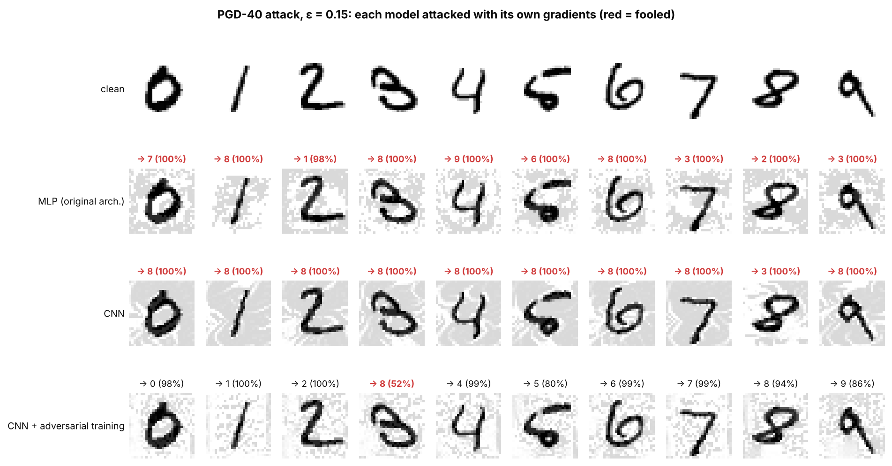
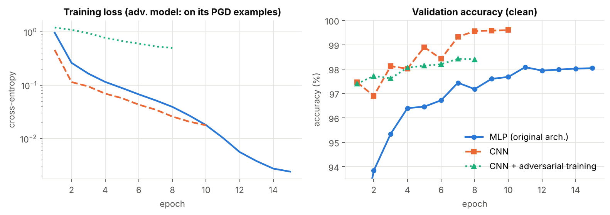
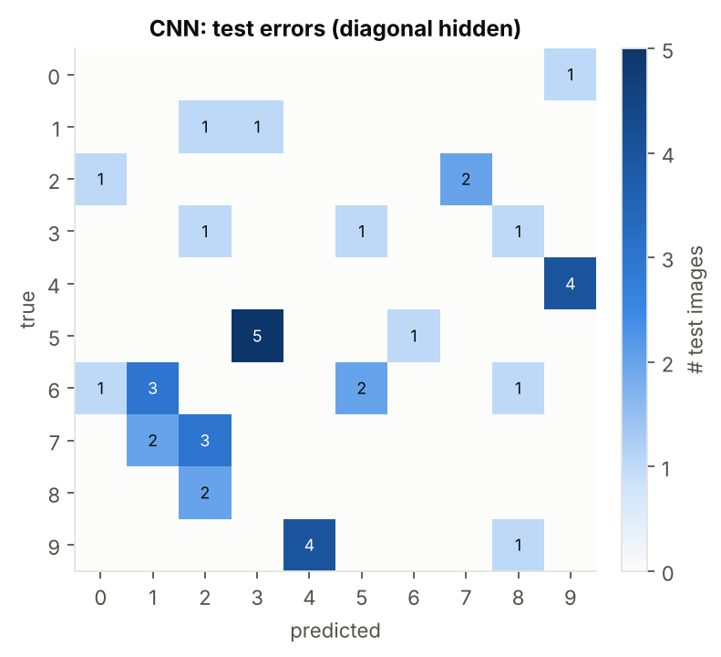
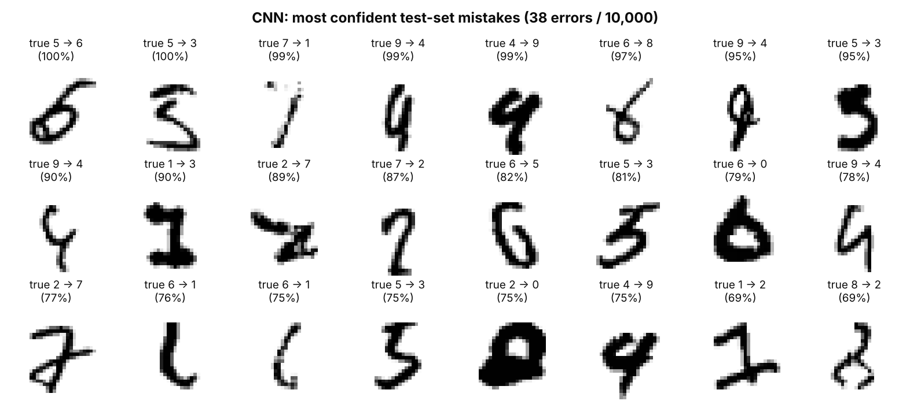

# Handwritten Digit Classification and Adversarial Robustness

MNIST digit classifiers in PyTorch (an MLP baseline and a CNN), white-box adversarial attacks (FGSM and PGD), and adversarial training that keeps **92.1% test accuracy under a PGD attack at ε = 0.3**, where the standard CNN drops to 0.05%. Includes an in-browser demo where you can draw a digit and attack the models.



## Results

All numbers are on the official 10,000-image MNIST **test set**, which is never used for training or model selection. Attacks are untargeted, L∞-bounded, in pixel units (images in [0, 1]); PGD uses 20 steps with a random start.

| Model | Params | Clean test acc. | FGSM ε=0.1 | PGD ε=0.1 | PGD ε=0.2 | PGD ε=0.3 |
|---|---:|---:|---:|---:|---:|---:|
| MLP (original architecture, 784-100-50-10) | 84,060 | 97.88% | 26.7% | 10.4% | 0.04% | 0.00% |
| CNN | 468,010 | **99.62%** | 28.4% | 8.0% | 0.75% | 0.05% |
| CNN + PGD adversarial training (ε = 0.3) | 468,010 | 98.78% | 97.9% | 97.6% | 95.9% | **92.1%** |

Full curves (ε = 0 to 0.3 in steps of 0.05) are in [`results/metrics.json`](results/metrics.json).

**Targeted attacks.** With targeted PGD (100 steps, ε = 0.2), the standard CNN can be pushed to a chosen wrong class in 86 of 90 (digit, target) pairs. The adversarially trained CNN is pushed to the target in 1 of 90.

| Standard CNN | Adversarially trained CNN |
|---|---|
|  |  |

### Findings

1. **The original 100% accuracy was data leakage.** The first version of this project trained on the 10k test split and evaluated on the same images. With a proper split (55k train / 5k validation / 10k test), the same MLP scores 97.88%.
2. **Accuracy and robustness are separate axes.** The CNN is far more accurate than the MLP (38 vs 212 test errors) but no more robust: both fall below 11% under PGD at ε = 0.1, a change of about 26 grey levels per pixel.
3. **FGSM overstates robustness.** At ε = 0.3, FGSM leaves the CNN at 14.4% while PGD brings it to 0.05%. Single-step attacks should not be the only evaluation.
4. **Fast adversarial training collapsed.** FGSM-with-random-start training (Wong et al., 2020) hit *catastrophic overfitting* at ε = 0.3: validation PGD accuracy reached 47.5% at epoch 3, then fell to 0.1% at epoch 4 and stayed near 0%, while accuracy on the model's own FGSM examples climbed to 99%. The model learned to defeat the single-step attack, not to be robust. Multi-step PGD training (Madry et al., 2018) fixed it. Logs: [`results/logs/`](results/logs/).
5. **Robustness costs some clean accuracy.** 99.62% falls to 98.78% (38 to 122 errors), the usual trade-off.
6. **Transfer looks asymmetric** (on the demo's 10 bench digits, so treat it as anecdotal). PGD examples crafted against the standard CNN fool the robust CNN on at most 1 of 10 digits, while examples crafted against the robust CNN fool the standard CNN on 9 of 10 at ε ≥ 0.2.



<details>
<summary>More figures: training curves, confusion matrices, CNN mistakes</summary>





</details>

## In-browser demo

[`demo/index.html`](demo/index.html) runs both CNNs in plain JavaScript with no ML framework: BatchNorm is folded into the convolutions and weights are stored as float16 (logits match PyTorch to within 0.004). You can:

- draw a digit (it gets the same crop, 20 × 20 rescale and centre-of-mass centring MNIST used) and compare the two models' probabilities, and
- move an ε slider over pre-computed PGD examples and watch the standard CNN fail while the robust one holds.

Open `demo/index.html` directly in a browser, or enable GitHub Pages (Settings → Pages → deploy from `main`, root) to serve it at `https://<user>.github.io/<repo>/demo/`.

## Project structure

```
digits/
  data.py         MNIST loading, train/val/test split, batched GPU-friendly augmentation
  models.py       MLP baseline and CNN; input normalisation lives inside the model
  attacks.py      FGSM and PGD (untargeted and targeted), clamped to [0, 1] and the ε-ball
  train.py        training loop: AdamW + OneCycle, augmentation, optional adversarial training
  evaluate.py     test metrics, attack curves, all figures in results/figures
  export_web.py   exports weights and an adversarial gallery for the browser demo
notebooks/walkthrough.ipynb   loads the checkpoints and reproduces the key results
tests/test_digits.py          unit tests (shapes, ε-ball constraints, attack direction)
checkpoints/                  trained weights (state_dict + architecture name)
results/                      metrics.json, figures, training logs
demo/                         index.html, digitnet.js (inference), model_data.js (weights)
```

## Reproduce

```bash
pip install -r requirements.txt

python -m digits.train --model mlp --epochs 15 --no-augment --lr 2e-3 --out checkpoints/mlp.pt
python -m digits.train --model cnn --epochs 10 --out checkpoints/cnn.pt
python -m digits.train --model cnn --epochs 8 --adv-eps 0.3 --adv-method pgd --adv-steps 5 --lr 1e-3 \
    --out checkpoints/cnn_adv.pt

python -m digits.evaluate          # results/metrics.json + figures (add --n-robust 2000 for a quick run)
python -m digits.export_web        # demo/model_data.js
pytest -q
```

MNIST downloads automatically to `data/`. On a 2-core CPU, training took about 15 s (MLP), 8 min (CNN) and 29 min (adversarial CNN); the full attack evaluation takes about 30 min, and attack curves are cached in `results/robust_cache.json`. A GPU is used automatically when available.

### Implementation notes

- **Normalisation inside the model.** Inputs stay in [0, 1], so ε always means "pixel units" and attacks clamp to the valid image range.
- **Checkpoints are `state_dict`s**, loaded with `torch.load(..., weights_only=True)`. The original project pickled the whole module, which breaks across code changes and PyTorch versions.
- **Model selection never touches the test set.** The best epoch is chosen on the validation split, by clean accuracy for standard training and by PGD-10 accuracy for adversarial training.
- **Adversarial examples for training are generated in train mode.** Generating them in eval mode let BatchNorm's batch and running statistics drift apart and collapsed clean validation accuracy to about 10% by epoch 3.

## References

- Goodfellow, Shlens, Szegedy. *Explaining and Harnessing Adversarial Examples.* ICLR 2015 (FGSM).
- Madry, Makelov, Schmidt, Tsipras, Vladu. *Towards Deep Learning Models Resistant to Adversarial Attacks.* ICLR 2018 (PGD, adversarial training).
- Wong, Rice, Kolter. *Fast is Better than Free: Revisiting Adversarial Training.* ICLR 2020 (FGSM + random start, catastrophic overfitting).
